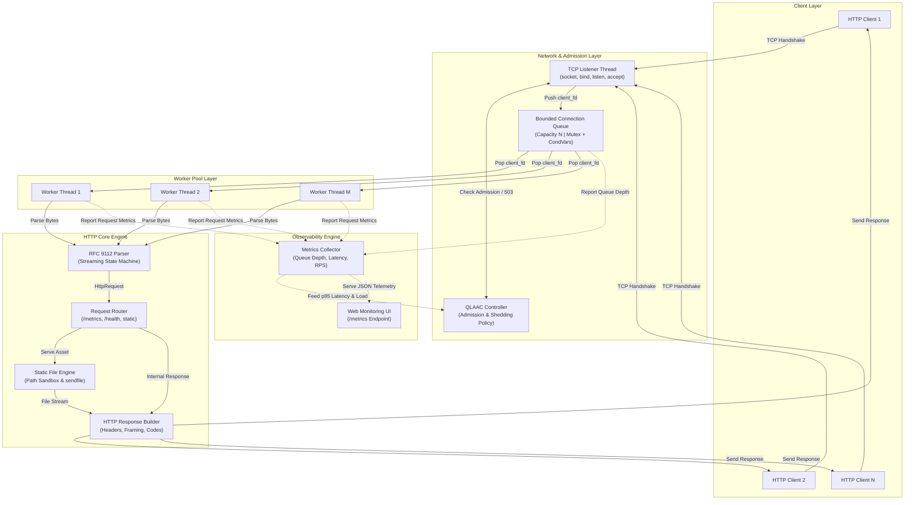
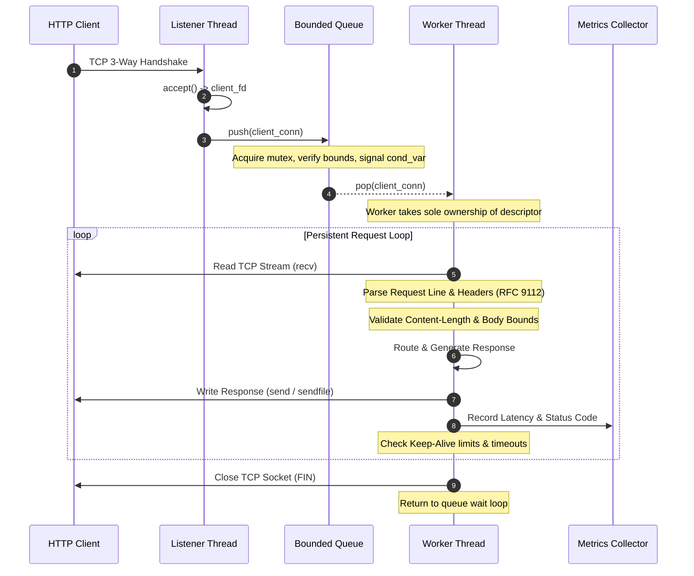
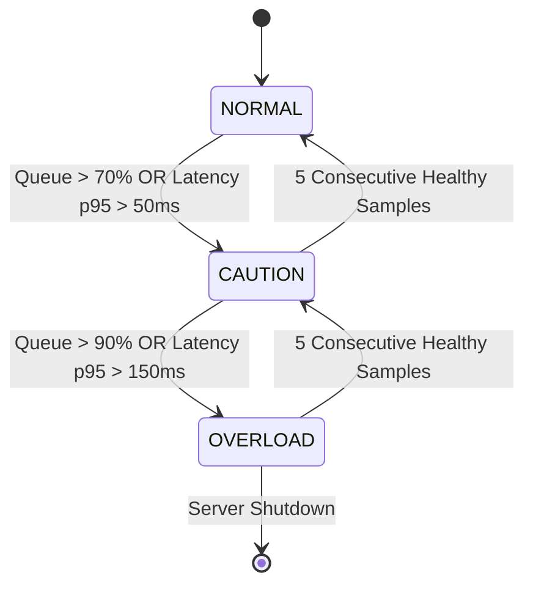

# Design and Implementation of a Multi-Threaded HTTP/1.1 Web Server from Scratch Using Raw TCP Sockets

Building a from-scratch HTTP/1.1 web server in **C17** using **raw POSIX TCP sockets** and **pthreads**, featuring custom streaming parsing, bounded concurrency, persistent connections, adaptive overload control, and reproducible benchmarking.

---

## Current Implementation Status

The following matrix documents the verification and completion state across all planned architectural modules. At this repository setup stage, the foundational repository scaffolds, documentation, configurations, test harnesses, and starter binaries are established. Core networking runtime and RFC protocol engines remain in active development.

- [ ] TCP listener and connection lifecycle
- [ ] HTTP request parser
- [ ] HTTP response builder
- [ ] Static-file routes
- [ ] Bounded connection queue
- [ ] pthread worker pool
- [ ] Persistent connections (Keep-Alive)
- [ ] Request and connection timeouts
- [ ] Security and resource safeguards
- [ ] Adaptive admission controller (QLAAC)
- [ ] Metrics endpoint (`/metrics`)
- [ ] Monitoring dashboard
- [ ] Automated functional tests
- [ ] Defensive parsing tests
- [ ] Reproducible benchmark scripts
- [ ] Experimental results and analysis
- [ ] Final project report PDF
- [ ] Final project presentation PPT

---

## Project Report and Presentation

The dedicated academic deliverables for this Computer Networks project are organized in their respective directories:

- **Project Report (PDF)**: [`deliverables/report/README.md`](deliverables/report/README.md) — Documentation guide and target destination for `HTTP11_Web_Server_Project_Report.pdf` (covering theoretical foundations, networking architecture, implementation analysis, and empirical evaluation).
- **Project Presentation (PPT)**: [`deliverables/presentation/README.md`](deliverables/presentation/README.md) — Documentation guide and target destination for `HTTP11_Web_Server_Project_Presentation.pptx` (comprehensive 18-slide oral defense presentation).

*Note: These directories contain complete deliverable specifications and outline guides. The finalized PDF and PPTX artifacts will be placed there following full implementation, test validation, and experimental benchmarking.*

---

## 1. Project Introduction

Modern web servers like Nginx and Apache are complex, mature software systems. However, standard web applications rarely expose the underlying operating system and networking primitives that make scalable web communication possible.

The objective of this project is to design and implement an academic-grade, highly performant **HTTP/1.1 Web Server from scratch in C17**. The server operates directly on raw POSIX TCP sockets (`AF_INET`, `SOCK_STREAM`) and POSIX threads (`pthreads`), completely eliminating any dependence on third-party HTTP parsing libraries or external server frameworks.

Key areas of technical emphasis include:
- **Transport-Layer Primitives**: Direct socket management, address binding, listen backlog tuning, and non-blocking stream I/O.
- **Protocol Precision**: Strict adherence to RFC 9112 syntax, header tokenization, message framing, and persistent connection semantics.
- **Controlled Concurrency**: A pre-allocated, fixed-size thread pool fed by a thread-safe, bounded FIFO connection queue.
- **Defensive Engineering**: Mitigating slowloris attacks, malformed request fuzzing, and filesystem path traversal without relying on external security layers.
- **Adaptive Overload Control**: Investigating an experimental Queue-and-Latency-Aware Admission Control (QLAAC) feedback loop.
- **Reproducible Performance Evaluation**: Empirical benchmarking across varying concurrency levels, thread pool sizes, and payload types.

---

## 2. Problem Statement

A naive socket-programming server typically accepts a connection, reads bytes until a newline is found, writes a hardcoded HTML string, and closes the connection. While functional for basic demonstrations, such an approach fails catastrophically under real-world networking conditions:

1. **TCP Byte-Stream Semantics**: TCP is an unstructured stream of bytes, not a message-oriented protocol. A single `recv()` call is never guaranteed to contain an entire HTTP request, nor does a single `send()` guarantee transmission of all bytes. Naive implementations suffer from truncated reads, broken headers, and partial writes.
2. **Concurrency & Thread Exhaustion**: Creating a new thread or process per connection (`fork-per-request`) leads to rapid memory exhaustion, kernel context-switch thrashing, and process table exhaustion under moderate concurrent load.
3. **Unbounded Queueing & Bufferbloat**: Allowing pending connections to queue without hard boundaries leads to high latency, memory bloat, and server crash under traffic bursts.
4. **Persistent Connection Management**: HTTP/1.1 mandates persistent connections (`Keep-Alive`) by default. The server must multiplex multiple sequential requests over a single TCP socket while respecting timeouts and request limits.
5. **Slow Clients & Resource Starvation**: Slow or hostile clients transmitting one byte every few seconds can exhaust available worker threads (Slowloris attack) unless explicit socket deadlines and read/write timeouts are enforced.
6. **Path Traversal & Filesystem Vulnerabilities**: Resolving requested URIs directly against local disk paths invites traversal attacks (e.g., `../../etc/passwd`), requiring strict canonical path validation.
7. **Lack of Empirical Observability**: Most academic servers fail to measure or understand internal queue dynamics, tail latency ($p95$/$p99$), or degradation patterns under severe load.

---

## 3. Project Objectives

1. **Raw Socket Transport**: Implement a robust TCP listener and connection manager using raw POSIX socket APIs (`socket`, `setsockopt`, `bind`, `listen`, `accept`).
2. **From-Scratch HTTP/1.1 Parser**: Develop a zero-dependency streaming request parser adhering to RFC 9112 grammar.
3. **Response Serialization**: Build a modular HTTP response engine generating standards-compliant status codes, headers, and formatted payloads.
4. **Static File Serving & Routing**: Implement secure static file delivery using Linux `sendfile(2)` and dynamic routing for virtual endpoints.
5. **Fixed-Size Worker Pool**: Construct a thread pool using `pthreads` to eliminate runtime thread creation overhead.
6. **Bounded Connection Queue**: Build a synchronized, thread-safe circular FIFO queue with strict capacity boundaries using mutexes and condition variables.
7. **Persistent Connections**: Support sequential HTTP/1.1 keep-alive connections with timeout mechanisms and maximum request counters.
8. **Defensive Resource Safeguards**: Enforce header size limits (8 KB), body limits (10 MB), path canonicalization (`realpath`), and socket timeouts.
9. **Experimental Overload Control**: Design and evaluate Queue-and-Latency-Aware Admission Control (QLAAC) across NORMAL, CAUTION, and OVERLOAD states.
10. **Thread-Safe Telemetry**: Build a real-time metrics collector tracking queue depth, active workers, throughput, and latency percentiles.
11. **Monitoring Dashboard**: Develop a web-based status portal visualizing telemetry polled from the `/metrics` endpoint.
12. **Rigorous Benchmarking**: Execute repeatable experiments comparing baseline and adaptive architectures across documented workloads.

---

## 4. Project Scope

```text
+-------------------------------------------------------+-------------------------------------------------------+
| Core In-Scope Features (Current Project Target)       | Planned Future Extensions (Out of Current Scope)      |
+-------------------------------------------------------+-------------------------------------------------------+
| • Raw POSIX TCP socket listener (IPv4/IPv6)          | • TLS/HTTPS encryption (OpenSSL integration)          |
| • Fixed-size pthread worker pool                      | • Chunked transfer-encoding request body decoding     |
| • Thread-safe bounded connection queue                | • HTTP/2 or HTTP/3 multiplexed framing               |
| • Streaming RFC 9112 HTTP/1.1 parser                 | • Range requests (206 Partial Content)                |
| • GET, HEAD, and bounded POST request handling        | • Dynamic CGI / FastCGI scripting execution           |
| • Static file serving with Linux sendfile(2)          | • Dynamic worker thread pool resizing                |
| • Sequential persistent connections (Keep-Alive)     | • Asynchronous event-loop architecture (epoll/io_uring)|
| • Path traversal prevention via realpath(3)           | • HTTP gzip / deflate compression                     |
| • Real-time /metrics JSON telemetry endpoint          |                                                       |
| • Experimental QLAAC adaptive admission control       |                                                       |
| • Automated unit & fuzzing test suites in C & Python  |                                                       |
| • Repeatable benchmarking framework (wrk integration) |                                                       |
+-------------------------------------------------------+-------------------------------------------------------+
```

---

## 5. System Architecture

The server architecture separates concerns into discrete, decoupled layers: Network Transport, Admission Control, Concurrency Pool, Protocol Parsing, Routing, and Observability.



---

## 6. HTTP Request Lifecycle

Every client connection traverses a deterministic, bounded lifecycle:

1. **TCP Connection Establishment**: Client initiates a 3-way TCP handshake (`SYN -> SYN-ACK -> ACK`).
2. **Acceptance**: The server's listener thread wakes on `accept()`, receiving a client socket descriptor and address.
3. **Admission Evaluation**: The listener checks queue capacity and queries the QLAAC controller. If the system is in `OVERLOAD`, the connection is rapidly handled with an HTTP `503 Service Unavailable` response and closed.
4. **Queue Enqueue**: Admitted connections are placed into the bounded circular FIFO queue, signaling a waiting worker via `pthread_cond_signal(&not_empty)`.
5. **Worker Dequeue**: An available worker thread pops the connection descriptor and takes exclusive ownership of the socket.
6. **Streaming Parse**: The worker invokes `tcp_read_stream()` and feeds bytes incrementally into `http_parser_consume()`. Because TCP is a byte stream, reads loop until headers are terminated by `\r\n\r\n`.
7. **Route Resolution**: `router_dispatch()` checks the requested method and URI against route tables.
8. **Response Generation**:
   - For static assets: The path is canonicalized via `realpath()`. If valid, headers are generated and the file is streamed via `sendfile(2)`.
   - For `/metrics`: A real-time JSON snapshot is serialized and written directly to the socket.
9. **Response Transmission**: Headers and body are transmitted using `tcp_write_all()`, ensuring all bytes are flushed even across partial network writes.
10. **Connection Reuse or Teardown**: If `Connection: keep-alive` is active and request limits have not been reached, the worker loops to await the next request on the same socket; otherwise, `close()` is called.
11. **Telemetry Update**: Latency, status codes, and bytes transferred are recorded into `MetricsCollector`.



---

## 7. Multithreading and Synchronization Model

To achieve predictable performance under load, the server employs a fixed worker-pool concurrency architecture:

- **Fixed-Size Worker Pool**: Spawns $M$ threads at startup (configured in `server.conf`). Avoids kernel thread creation costs and limits concurrent execution to match available CPU resources.
- **Bounded Connection Queue**: Fixed-capacity circular buffer ($N$ slots). Solves the unbounded bufferbloat problem; prevents excessive memory usage during traffic bursts.
- **Synchronization Primitives**:
  - `pthread_mutex_t`: Protects queue head, tail, and count during enqueue/dequeue operations.
  - `pthread_cond_t not_empty`: Workers sleep on this condition variable when the queue has 0 entries.
  - `pthread_cond_t not_full`: The listener blocks or yields on this variable when queue reaches capacity.
- **Descriptor Ownership Discipline**: Only **one** thread interacts with a client descriptor at any time. The listener transfers ownership upon enqueue, the worker assumes ownership on dequeue, and the worker alone performs `close()`.
- **Graceful Shutdown**: The main thread intercepts `SIGINT`/`SIGTERM`, sets an atomic shutdown flag, broadcasts to all condition variables, drains pending work, and joins all worker threads via `pthread_join()`.

---

## 8. Proposed Adaptive Admission Control (QLAAC)

To study server behavior under extreme load, this project designs and evaluates an experimental overload mitigation mechanism: **Queue-and-Latency-Aware Admission Control (QLAAC)**.

> **Research Status**: QLAAC is a proposed experimental controller under active evaluation. It is not presented as a completed innovation and will be empirically evaluated against a static queue baseline under identical workloads.

### 8.1 Controller State Machine



### 8.2 Operational States & Actions
1. **NORMAL State**:
   - Connection queue and latency metrics are within nominal limits.
   - Standard admission policy; persistent connections (`Keep-Alive`) fully supported.
2. **CAUTION State**:
   - Queue occupancy breaches `queue_caution_threshold` (e.g. 70%) or $p95$ latency exceeds `latency_caution_ms` (e.g. 50 ms).
   - Server tightens keep-alive limits, reduces idle timeouts, and signals clients to close idle connections.
3. **OVERLOAD State**:
   - Queue occupancy breaches `queue_overload_threshold` (e.g. 90%) or $p95$ latency exceeds `latency_overload_ms` (e.g. 150 ms).
   - Immediate load shedding: Newly arriving connections are immediately returned an HTTP `503 Service Unavailable` with `Retry-After: 5` header and closed before workers become saturated.
4. **Hysteresis Dampening**:
   - Requires $K$ consecutive healthy sampling windows (default: 5) before transitioning down a tier to prevent rapid state oscillation (flapping).

---

## 9. Technology Stack

| Technology | Role / Purpose | Technical Rationale |
| :--- | :--- | :--- |
| **C17** | Core Server Implementation | Direct hardware/OS interface control; zero runtime overhead; strict standards compliance. |
| **POSIX TCP Sockets** | Network Transport Layer | `socket`, `bind`, `listen`, `accept`, `setsockopt` for raw transport manipulation. |
| **pthreads** | Worker Pool Concurrency | POSIX standard threading, mutexes (`pthread_mutex_t`), and condition variables (`pthread_cond_t`). |
| **Linux / Ubuntu** | Development & Execution Host | Reference POSIX operating system environment with kernel diagnostic tooling. |
| **POSIX File APIs** | Static Asset Handling | `open`, `fstat`, `realpath` for safe filesystem traversal and asset management. |
| **`sendfile(2)`** | High-Performance Zero-Copy I/O | Transfers file data directly from kernel page cache to socket descriptor. |
| **HTML5 / CSS / JS** | Observability Dashboard | Responsive web frontend polling `/metrics` for real-time visualization. |
| **Python 3** | Test & Benchmark Orchestration | Scripting harness for functional verification, socket fuzzing, and benchmark aggregation. |
| **curl** *(External)* | Functional Protocol Verification | Standard CLI utility for manual and automated HTTP/1.1 request validation. |
| **wrk** *(External)* | Load Generation & Benchmarking | High-concurrency multithreaded HTTP benchmark generator for latency distributions. |
| **Wireshark** *(External)* | Packet Inspection & Diagnostics | Protocol analyzer for inspecting TCP handshakes, packet fragmentation, and TCP RST flags. |
| **Git & GitHub** | Version Control & Collaboration | Tracking incremental systems implementation and project documentation. |

---

## 10. HTTP/1.1 Protocol Support & Standards Compliance

The server targets compliance with the core provisions of [RFC 9112](https://www.rfc-editor.org/rfc/rfc9112.html):

- **Request-Line Grammar**: `Method SP Request-URI SP HTTP-Version CRLF` strictly enforced.
- **Supported Methods**: `GET`, `HEAD`, and bounded `POST`. Unsupported verbs return `405 Method Not Allowed`.
- **Header Parsing**: Case-insensitive lookup (`strcasecmp`); whitespace trimming; 8 KB maximum header block limit.
- **Framing & Content-Length**: Integer validation; conflicting or duplicate `Content-Length` headers rejected (`400 Bad Request`).
- **Persistent Connections**: Sequential request handling over persistent sockets; idle timeouts; clean `Connection: close` termination.
- **Defensive Error Handling**: Clear mapping to standard status codes (`200`, `204`, `301`, `400`, `403`, `404`, `405`, `408`, `413`, `414`, `431`, `500`, `503`).

---

## 11. Security and Reliability Architecture

The server implements multi-layered defensive safeguards:

1. **Path Traversal Defense**: All candidate paths are canonicalized using `realpath(3)` and verified to reside strictly within `public_root`. Null bytes (`\0`) and directory listing attempts are blocked (`403 Forbidden`).
2. **Slowloris Mitigation**: Socket receive (`SO_RCVTIMEO`) and send (`SO_SNDTIMEO`) timeouts (5s) terminate idle or trickle connections.
3. **Buffer & Memory Bounds**: Hard limits on request lines (2 KB), headers (8 KB), and POST bodies (10 MB) prevent OOM vulnerabilities.
4. **File Descriptor Leak Prevention**: Socket descriptors are strictly owned by assigned worker threads and guaranteed to close on all terminating execution paths.
5. **Clean Signal Handling**: `SIGINT` and `SIGTERM` signals trigger coordinated worker pool draining and memory cleanup.

---

## 12. Monitoring and Observability

The server exposes real-time runtime telemetry via a thread-safe JSON endpoint (`/metrics`):

- **Connection Metrics**: Total accepted connections, rejected connections, current queue depth.
- **Worker Utilization**: Active worker thread count vs. total pool capacity.
- **Throughput & Status**: Total completed requests, requests per second (RPS), status code breakdown (`2xx`, `3xx`, `4xx`, `5xx`).
- **Latency Percentiles**: Rolling median ($p50$), 95th percentile ($p95$), and 99th percentile ($p99$) response times.
- **QLAAC State**: Instantaneous controller state (`NORMAL`, `CAUTION`, `OVERLOAD`) and cumulative shedding events.

The companion monitoring dashboard (`public/index.html`) visualizes these metrics in real time.

---

## 13. Benchmarking and Experimental Methodology

The evaluation strategy comprises five controlled experimental suites designed to collect empirical, reproducible performance data:

- **Experiment A (Concurrency Scaling)**: Evaluates throughput and latency scaling across worker threads ($1, 2, 4, 8, 16$) and concurrent clients ($1, 10, 50, 100, 200$).
- **Experiment B (Adaptive Overload Control)**: Compares static queue baseline against QLAAC under burst traffic, measuring tail latency ($p95$/$p99$), rejection rates, and recovery time.
- **Experiment C (Persistent Connections)**: Quantifies latency and CPU differences between Keep-Alive enabled and `Connection: close`.
- **Experiment D (Workload Variations)**: Measures I/O throughput across 1 KB, 100 KB, and 5 MB static files, contrasting user-space writes with `sendfile(2)`.
- **Experiment E (Reliability & Fuzzing)**: Fuzzes malformed request lines, oversized headers, and slowloris trickle patterns to confirm defensive stability.

### Initial Testing Configuration Matrix

| Parameter | Planned Evaluation Values |
| :--- | :--- |
| **Worker Thread Count** | $1, 2, 4, 8, 16$ |
| **Concurrent Client Connections** | $1, 10, 50, 100, 200$ |
| **Resource Sizes** | 1 KB, 100 KB, 5 MB static files; `/metrics` API endpoint |
| **Connection Mode** | Separate connection per request; persistent Keep-Alive |
| **Load Patterns** | Gradual ramp, sustained steady state, sudden step-burst |
| **Server Policy** | Single-threaded baseline, fixed thread pool, adaptive QLAAC |

*Note: Benchmarking figures will be populated exclusively from live execution runs on documented hardware. No fabricated numbers are presented.*

---

## 14. Repository Structure

```text
.
├── README.md                      # Comprehensive project guide and architectural specification
├── .gitignore                     # Git ignore rules for build artifacts, OS files, and logs
├── LICENSE                        # Project license notice and terms
├── Makefile                       # C17 Linux build automation with strict compiler warnings
│
├── config/
│   └── server.conf.example        # Documented server configuration file template
│
├── include/                       # Public C header files (interfaces and data structures)
│   ├── server.h                   # Top-level server lifecycle, configuration, and event loop
│   ├── tcp_socket.h               # Raw POSIX TCP socket abstraction and robust stream I/O
│   ├── http_parser.h              # RFC 9112 streaming request parser interface
│   ├── http_response.h            # Response formatting, status codes, and serialization
│   ├── thread_pool.h              # Fixed-size pthread worker pool interface
│   ├── connection_queue.h         # Thread-safe bounded connection queue
│   ├── metrics.h                  # Thread-safe runtime telemetry collector
│   └── adaptive_controller.h      # QLAAC adaptive overload admission controller
│
├── src/                           # C source modules (implementations and scaffolds)
│   ├── main.c                     # Starter entry point and scaffold diagnostic utility
│   ├── server.c                   # Top-level lifecycle orchestrator
│   ├── tcp_socket.c               # POSIX socket networking implementation
│   ├── http_parser.c              # Streaming HTTP/1.1 request parser
│   ├── http_response.c            # Response formatting and status phrase mappings
│   ├── router.c                   # Route dispatching and endpoint mapping
│   ├── static_files.c             # Secure static file resolution and sendfile support
│   ├── thread_pool.c              # Worker thread lifecycle and management
│   ├── connection_queue.c         # Bounded circular queue synchronization logic
│   ├── metrics.c                  # Metrics counters and JSON formatting
│   └── adaptive_controller.c      # QLAAC state machine and admission logic
│
├── public/                        # Static assets and web monitoring interface
│   ├── index.html                 # Static demonstration page and live telemetry dashboard
│   └── demo-assets/               # Static assets (images, stylesheets, scripts)
│       └── .gitkeep
│
├── tests/                         # Automated testing and validation suites
│   ├── test_parser.c              # Unit test runner for HTTP request parser
│   ├── test_responses.c           # Unit test runner for HTTP response formatting
│   ├── test_keepalive.py          # Python persistent connection test suite
│   ├── test_malformed_requests.py # Python malformed request fuzzing suite
│   └── test_security.py           # Python path traversal and boundary test suite
│
├── benchmark/                     # Benchmarking harness and load testing tools
│   ├── README.md                  # Benchmarking guide, tooling overview, and instructions
│   ├── run_experiment.py          # Automated experiment runner and CSV logger
│   └── configurations/            # Parameter profiles for repeatable benchmark runs
│       └── .gitkeep
│
├── results/                       # Empirical benchmark outputs (version-controlled data)
│   ├── raw/                       # Unprocessed CSV logs from benchmark trials
│   │   └── .gitkeep
│   ├── processed/                 # Aggregated summary statistics
│   │   └── .gitkeep
│   └── plots/                     # Rendered performance charts and latency distributions
│       └── .gitkeep
│
├── docs/                          # In-depth technical documentation
│   ├── architecture.md            # Detailed subsystem architecture and sequence diagrams
│   ├── protocol-support.md        # RFC 9112 compliance specification and method matrix
│   ├── security-design.md         # Threat model, input validation, and defensive measures
│   └── experiment-methodology.md  # Experimental design, QLAAC evaluation, and matrix
│
└── deliverables/                  # Dedicated academic deliverable locations
    ├── report/
    │   └── README.md              # Final Report documentation and outline for HTTP11_Web_Server_Project_Report.pdf
    └── presentation/
        └── README.md              # Final Presentation documentation and outline for HTTP11_Web_Server_Project_Presentation.pptx
```

---

## 15. Build and Run Instructions

### Prerequisites (Linux / Ubuntu)

Install the C build toolchain, Python testing runtime, and benchmarking utilities:

```bash
# Update package index
sudo apt-get update

# Install GCC compiler, GNU Make, and build tools
sudo apt-get install -y build-essential gcc make

# Install Python 3 for test orchestration
sudo apt-get install -y python3 python3-pip

# Optional: Install wrk for HTTP load generation benchmarking
sudo apt-get install -y wrk
```

### Building the Starter Scaffold Binary

The provided `Makefile` compiles the scaffold entry-point binary with strict C17 compiler warnings enabled (`-std=c17 -Wall -Wextra -Wpedantic`):

```bash
# Build the scaffold binary
make all

# Verify scaffold integrity and compiler flags
./bin/server --check-scaffold

# View command-line usage flags
./bin/server --help
```

### Executing Test Suites

```bash
# Compile and execute C unit tests and Python test harnesses
make test
```

### Cleaning Build Artifacts

```bash
make clean
```

> **Planned Runtime Command**: Once the core socket listener is integrated in subsequent phases, the operational server will be launched via:
> ```bash
> # (Planned Phase 1 Execution Command)
> ./bin/server -c config/server.conf.example
> ```

---

## 16. Engineering Practices

- **Strict Warning Compliance**: Compiled with `-std=c17 -Wall -Wextra -Wpedantic -Wformat=2 -Wshadow -Wwrite-strings -Wstrict-prototypes` to prevent undefined behaviors.
- **Descriptor & Memory Invariants**: Explicit ownership tracking guarantees no socket descriptors are leaked on abnormal error paths.
- **Defensive String & Buffer Operations**: Bounded string operations (`snprintf`, `strncmp`) replace unsafe APIs (`sprintf`, `strcpy`).
- **No Mock Statistics**: Strict academic policy: zero fabricated performance numbers or mock charts.

---

## 17. References

1. **RFC 9112**: Fielding, R., Nottingham, M., & Reschke, J. (2022). *HTTP/1.1*. Internet Engineering Task Force (IETF). [https://www.rfc-editor.org/rfc/rfc9112.html](https://www.rfc-editor.org/rfc/rfc9112.html)
2. **RFC 9110**: Fielding, R., Nottingham, M., & Reschke, J. (2022). *HTTP Semantics*. Internet Engineering Task Force (IETF). [https://www.rfc-editor.org/rfc/rfc9110.html](https://www.rfc-editor.org/rfc/rfc9110.html)
3. **Linux Programmer's Manual**:
   - `socket(2)`: [https://man7.org/linux/man-pages/man2/socket.2.html](https://man7.org/linux/man-pages/man2/socket.2.html)
   - `bind(2)`: [https://man7.org/linux/man-pages/man2/bind.2.html](https://man7.org/linux/man-pages/man2/bind.2.html)
   - `listen(2)`: [https://man7.org/linux/man-pages/man2/listen.2.html](https://man7.org/linux/man-pages/man2/listen.2.html)
   - `accept(2)`: [https://man7.org/linux/man-pages/man2/accept.2.html](https://man7.org/linux/man-pages/man2/accept.2.html)
   - `recv(2)`: [https://man7.org/linux/man-pages/man2/recv.2.html](https://man7.org/linux/man-pages/man2/recv.2.html)
   - `send(2)`: [https://man7.org/linux/man-pages/man2/send.2.html](https://man7.org/linux/man-pages/man2/send.2.html)
   - `sendfile(2)`: [https://man7.org/linux/man-pages/man2/sendfile.2.html](https://man7.org/linux/man-pages/man2/sendfile.2.html)
   - `pthreads(7)`: [https://man7.org/linux/man-pages/man7/pthreads.7.html](https://man7.org/linux/man-pages/man7/pthreads.7.html)
4. **wrk**: Glozer, W. (2023). *wrk - Modern HTTP benchmarking tool*. GitHub Repository. [https://github.com/wg/wrk](https://github.com/wg/wrk)
5. **Wireshark Foundation**: *Wireshark User's Guide*. [https://www.wireshark.org/docs/wsug_html_chunked/](https://www.wireshark.org/docs/wsug_html_chunked/)
