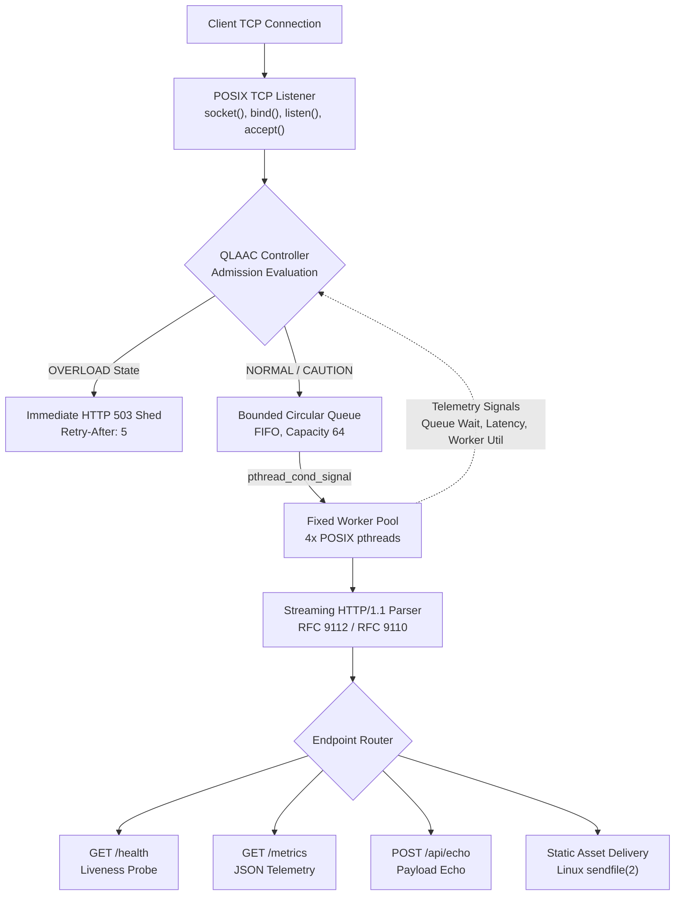
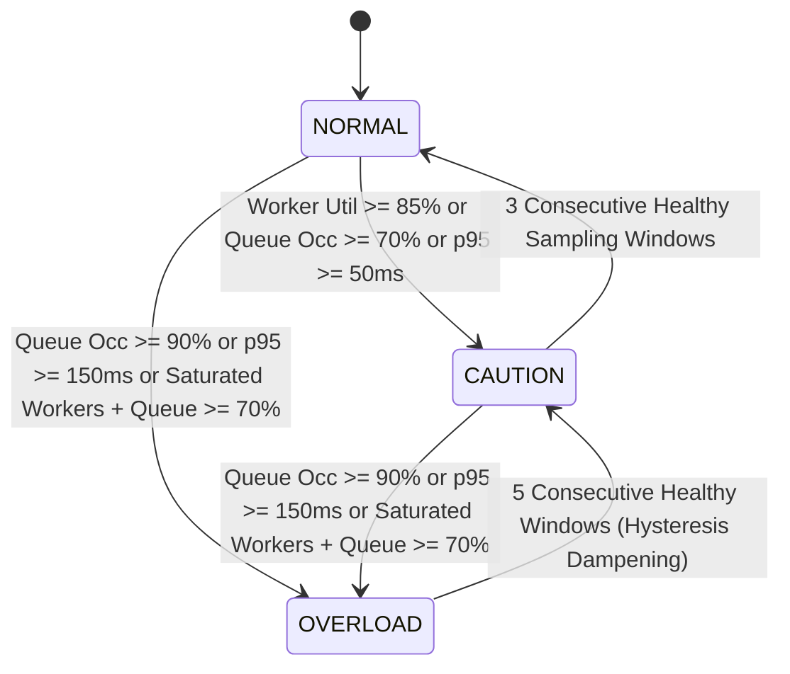
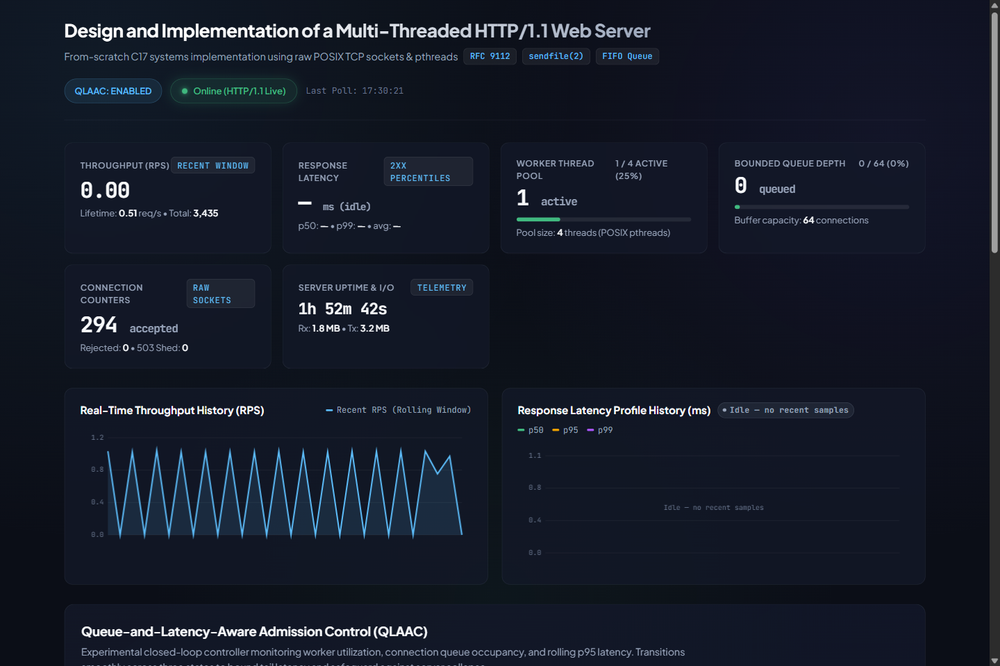

# Design and Implementation of a Multi-Threaded HTTP/1.1 Web Server from Scratch Using Raw TCP Sockets

[](src/)
[](./)
[](https://www.rfc-editor.org/rfc/rfc9112.html)
[-success)](deliverables/final_submission/Report_Verification_Checklist.md)
[](deliverables/final_submission/CN_Project_Final_Report_Final_Submission.pdf)

A high-performance, zero-dependency academic systems implementation of an RFC 9112 / RFC 9110 **HTTP/1.1 Web Server built strictly from scratch** using low-level POSIX TCP Berkeley sockets (`AF_INET`, `SOCK_STREAM`) and POSIX threads (`pthreads`).

Developed for the **BCSE308P Computer Networks Laboratory Course** (Fall Semester 2026–27, School of Computer Science and Engineering), this project bridges transport-layer socket dynamics with application-layer protocol framing. It features zero-copy streaming request parsing, a thread-safe bounded circular FIFO connection queue, fixed-size worker pool concurrency, Linux kernel `sendfile(2)` static asset delivery, real-time in-memory telemetry, an HTML5/Canvas monitoring dashboard, and an experimental closed-loop **Queue-and-Latency-Aware Admission Controller (QLAAC)** designed to mitigate tail-latency bufferbloat collapse under extreme traffic surges.

---

## Table of Contents

- [Project Team](#project-team)
- [Project Overview & Motivation](#project-overview--motivation)
- [Key Features](#key-features)
- [System Architecture & Request Lifecycle](#system-architecture--request-lifecycle)
- [QLAAC Adaptive Controller](#qlaac-adaptive-controller)
- [Prerequisites & Target Environment](#prerequisites--target-environment)
- [Quick Start & Build Instructions](#quick-start--build-instructions)
- [Verified API Endpoints](#verified-api-endpoints)
- [Testing & Quality Assurance](#testing--quality-assurance)
- [Empirical Benchmarking & Results](#empirical-benchmarking--results)
- [Authentic Visual Evidence & Screenshots](#authentic-visual-evidence--screenshots)
- [Academic Deliverables](#academic-deliverables)
- [Engineering Limitations & Security Considerations](#engineering-limitations--security-considerations)
- [Repository Structure](#repository-structure)
- [Academic Context & Attribution](#academic-context--attribution)

---

## Project Team

| Registration Number | Student Name | GitHub Profile / Contact |
| :---: | :---: | :---: |
| **24BCE0702** | **[Yash Pradhan](https://github.com/yoswinner)** | [yoswinner](https://github.com/yoswinner) |
| **24BCE0714** | **Anjini Pandey** | [jini0703](https://github.com/jini0703) |

*Course:* **Computer Networks Lab (BCSE308P)**<br>
*Academic Term:* **Fall Semester 2026–27**<br>
*School / Department:* **School of Computer Science and Engineering**

---

## Project Overview & Motivation

Production HTTP servers such as NGINX, Apache, and Envoy rely on complex event loops and third-party utility libraries that abstract away the transport layer. In networking curricula, students frequently interact with HTTP only through high-level application frameworks (e.g., Express, Flask, Actix), obscuring how the operating system manages underlying network descriptors, socket queues, and thread coordination.

This project demystifies transport and application layer interaction by engineering an HTTP/1.1 server from first principles in **strict ISO C17**:
1. **Bridging Byte Streams to Protocol Frames:** TCP is an unstructured, stream-oriented byte-stream transport with no native message boundaries. The application must handle partial reads, arbitrary TCP segmentation, header tokenization, and framing delimitation without memory corruption.
2. **Deterministic Resource Bounds:** Unbounded "thread-per-client" or "fork-per-connection" models trigger kernel context-switch thrashing and virtual memory exhaustion ($10,000 \times 8\text{ MB} = 80\text{ GB}$). Our server enforces strict thread pool and circular queue limits.
3. **Bufferbloat & Tail-Latency Degeneracy:** Under burst load, unmanaged queues accumulate connections. By Little's Law ($L = \lambda W$), queue wait time explodes, degrading tail latency ($p99 > 400\text{ ms}$). We implement **QLAAC**, a closed-loop controller that sheds excess load early via HTTP 503 (`Retry-After: 5`) to preserve low latency for admitted connections.
4. **Defensive Systems Programming:** Robust mitigation of directory traversal (`realpath`), header overflow attacks (8 KB limit), body overflows (10 MB limit), and Slowloris starvation via socket receive/send deadlines (`SO_RCVTIMEO` / `SO_SNDTIMEO`).

---

## Key Features

- **Raw POSIX Socket Transport:** IPv4 stream listener utilizing `SO_REUSEADDR`, `TCP_NODELAY` (disabling Nagle's algorithm for low latency), and non-blocking polling deadlines.
- **Fixed-Size pthread Worker Pool:** Pre-allocated worker pool (configurable, default 4 threads) eliminating runtime thread-creation overhead and process-table exhaustion.
- **Thread-Safe Bounded FIFO Connection Queue:** Circular buffer (default capacity 64 connections) synchronized via POSIX mutual exclusion (`pthread_mutex_t`) and condition variables (`pthread_cond_t`).
- **Streaming RFC 9112 / 9110 Parser:** Zero-copy request tokenization, case-insensitive header lookup, strict `Host` header enforcement, decimal `Content-Length` framing, and rejection of conflicting `Transfer-Encoding` + `Content-Length`.
- **Persistent HTTP/1.1 Connections (Keep-Alive):** Reuses TCP connections across sequential requests with configurable idle timeouts and request counters.
- **Zero-Copy Static File Delivery:** Employs Linux kernel `sendfile(2)` to stream disk blocks directly to network sockets without user-space buffer copying, with dynamic `lseek(SEEK_CUR)` offset fallback tracking.
- **Canonical Filesystem Sandboxing:** Resolves all URI paths using `realpath(3)` and `O_NOFOLLOW` checks to strictly prevent parent-directory traversal (`../`, `%2e%2e`).
- **Real-Time Observability Engine:** In-memory lock-free reservoir sampling computing sliding-window RPS and rolling latency percentiles ($p50, p95, p99$).
- **Live HTML5 Telemetry Dashboard:** Integrated single-page web dashboard displaying live cards, Canvas throughput/latency histories, and an interactive diagnostic console.
- **Dual Test Harness:** 92 automated tests across dual C and Python test suites (44 C17 unit tests across 5 executables, and 48 Python protocol, security, accounting, and readiness probe tests; 100% passing against an active server).

---

## System Architecture & Request Lifecycle

The server follows a decoupled producer-consumer architecture separating connection acceptance from worker request execution:



*High-Resolution Architectural Diagram:* [`results/plots/fig4_system_architecture.png`](results/plots/fig4_system_architecture.png)

### Request Execution Lifecycle
1. **Ingress & Handshake:** Client completes TCP three-way handshake; OS queues connection in the kernel listen backlog.
2. **Accept & Assessment:** Main listener thread calls `accept(2)`. The QLAAC controller evaluates worker saturation, current queue depth, and rolling tail latency.
3. **Queue Enqueue:** If admitted, socket descriptor is pushed to the thread-safe circular FIFO buffer; sleeping worker is awakened via `pthread_cond_signal`.
4. **Worker Dispatch:** Worker retrieves socket, enforces socket receive deadline (`SO_RCVTIMEO`), and reads byte stream into streaming buffer.
5. **Streaming Parsing:** The RFC 9112 parser processes tokens without allocating memory, extracting method, URI, headers, and body boundary.
6. **Route Dispatch:** Router evaluates URI:
   - `/health` or `/status`: Serializes server liveness status JSON.
   - `/metrics`: Serializes atomic telemetry snapshot (connections, throughput, percentiles, QLAAC state).
   - `/api/echo`: Reads `Content-Length` bounded payload and echoes body with matching `Content-Type`.
   - Static resources: Invokes `realpath(3)` to verify sandbox integrity, reads file metadata, and streams via `sendfile(2)`.
7. **Keep-Alive or Close:** If `Connection: keep-alive` is active and limits are respected, socket remains open for subsequent requests; otherwise, worker closes descriptor cleanly.

---

## QLAAC Adaptive Controller

Queue-and-Latency-Aware Admission Control (**QLAAC**) is an experimental closed-loop controller designed to mitigate tail-latency degradation (bufferbloat) in multi-threaded servers under heavy concurrency.



*State Machine Diagram:* [`results/plots/fig5_qlaac_state_machine.png`](results/plots/fig5_qlaac_state_machine.png)

### Controller Invariants & Thresholds

| State | Operational Behavior | Entry Invariant | Exit / Recovery Rule |
| :--- | :--- | :--- | :--- |
| **`NORMAL`** | All incoming connections and requests admitted. Full persistent Keep-Alive connections supported. | Worker util $< 85\%$, Queue occupancy $< 70\%$, $p95$ latency $< 50\text{ ms}$. | Transitions to `CAUTION` if any caution threshold is breached. |
| **`CAUTION`** | All requests admitted. Keep-Alive is throttled by injecting `Connection: close` headers (or 16 requests/connection limit) to drain persistent connections and relieve queue pressure. | Worker util $\ge 85\%$, Queue occupancy $\ge 70\%$, or $p95 \ge 50\text{ ms}$. | Steps down to `NORMAL` after 3 consecutive healthy sampling windows. |
| **`OVERLOAD`** | Immediate request shedding via `HTTP/1.1 503 Service Unavailable` with `Retry-After: 5` header at accept gate. Preserves bounded latency for admitted work. | Queue occupancy $\ge 90\%$, $p95 \ge 150\text{ ms}$, or saturated workers ($100\%$) coupled with growing queue ($\ge 70\%$) or sustained pressure ($\ge 3$ windows). | Requires **5 consecutive healthy sampling windows** (hysteresis dampening) before stepping down to `CAUTION`. |

*Source Implementation:* [`src/adaptive_controller.c`](src/adaptive_controller.c) | Header: [`include/adaptive_controller.h`](include/adaptive_controller.h)

---

## Prerequisites & Target Environment

> [!IMPORTANT]
> **POSIX Environment Requirement:**
> This web server is implemented in **POSIX C17** using Linux Berkeley sockets (`sys/socket.h`), Linux kernel zero-copy (`sys/sendfile.h`), and POSIX threads (`pthread.h`). It is **not** a native Windows Winsock implementation.
> - **Supported Platforms:** Linux x86_64 / aarch64 (Ubuntu 22.04+, Debian 12+, Fedora, Arch) or Windows 11 via **WSL2** (Ubuntu / Debian).
> - **Compilers:** GCC 11+ or Clang 13+ with C17 standard support.

### System Package Installation (Debian / Ubuntu / WSL2)

```bash
# Update package index and install compiler toolchain
sudo apt-get update
sudo apt-get install -y build-essential gcc make python3 python3-pip curl
```

---

## Quick Start & Build Instructions

### 1. Compile the Server

```bash
# Clone the repository
git clone https://github.com/jini0703/Design_and_Implementation_of_a_Multi-Threaded_HTTP-1.1_Web_Server_from_Scratch_Using_Raw_TCP_Sockets.git
cd Design_and_Implementation_of_a_Multi-Threaded_HTTP-1.1_Web_Server_from_Scratch_Using_Raw_TCP_Sockets

# Build the server executable
make all

# Verify scaffold and compiler standards
./bin/server --check-scaffold
```

### 2. Start the Server

```bash
# Option A: Start with example configuration file (port 8080, baseline)
./bin/server -c config/server.conf.example

# Option B: Start directly with custom CLI flags and QLAAC adaptive controller enabled
./bin/server -p 8080 -d ./public -t 4 -a
```

### 3. Open the Monitoring Dashboard

Navigate to the live dashboard in your web browser:
```text
http://127.0.0.1:8080/
```

### 4. Verify Endpoints via Terminal

```bash
# Test 1: Liveness / Readiness health check
curl -i http://127.0.0.1:8080/health

# Test 2: In-memory runtime telemetry snapshot
curl -s http://127.0.0.1:8080/metrics

# Test 3: HTTP POST body echo endpoint
curl -i -X POST http://127.0.0.1:8080/api/echo \
     -H "Content-Type: text/plain" \
     -d "Hello from systems networking verification!"

# Test 4: Static file serving (dashboard HTML)
curl -i http://127.0.0.1:8080/index.html
```

### 5. Graceful Shutdown

The server catches `SIGINT` (Ctrl+C) and `SIGTERM`, safely broadcasting shutdown signals to all worker threads, draining the connection queue, and closing active socket descriptors:
```bash
# Press Ctrl+C in server terminal, or send signal:
pkill -INT server
```

---

## Verified API Endpoints

| Method | Endpoint | Purpose | Implemented Behavior & Status Codes |
| :--- | :--- | :--- | :--- |
| `GET`, `HEAD` | `/` or `/index.html` | Systems Monitoring Dashboard | Zero-copy delivery via `sendfile(2)`. Returns `200 OK` (`text/html`). |
| `GET`, `HEAD` | `/health` or `/status` | Server Liveness / Readiness Probe | Returns `200 OK` with JSON payload `{"status":"healthy","server":"HTTP-Server-C17/1.0.0","protocol":"HTTP/1.1"}`. Non-GET/HEAD returns `405 Method Not Allowed`. |
| `GET`, `HEAD` | `/metrics` | Telemetry Observability | Returns `200 OK` with atomic telemetry JSON (queue depth, active workers, RPS, percentiles, QLAAC state). Non-GET/HEAD returns `405`. Returns `404` if disabled in config. |
| `POST` | `/api/echo` | Payload Echo Verification | Reads `Content-Length` bounded body (up to 10 MB) and echoes payload with incoming `Content-Type`. Non-POST returns `405 Method Not Allowed`. |
| `GET`, `HEAD` | `/<static-file>` | Static Asset Streaming | Streams static files from `./public`. Returns `200 OK`, or `404 Not Found` if file does not exist. |
| *Any* | *Path Traversal* (e.g. `../../`) | Security Defense | Blocked by `realpath(3)` sandbox check. Returns `404 Not Found` or `403 Forbidden`. |
| *Unsupported* | `TRACE`, `PUT`, `DELETE` | Method Restriction | Returns `501 Not Implemented` or `405 Method Not Allowed`. |
| *Any* | *Overload Condition* | QLAAC Overload Protection | Under critical queue/latency in `OVERLOAD`, returns `503 Service Unavailable` with `Retry-After: 5`. |

---

## Testing & Quality Assurance

The codebase features an automated multi-tier test harness covering low-level C components and network protocol behaviors.

### Executing the Test Suites

```bash
# 1. Execute C17 unit test suites (5 test executables, 44 tests)
make test

# 2. Execute Python RFC compliance, security, and accounting suites (48 tests)
python3 -m unittest discover -s tests -p "test_*.py" -v
```

### Verified Test Results (92 / 92 Passing — 100% Pass Rate with Running Server)

```text
================================================================================
HTTP/1.1 Web Server - Verification Summary (Current Suite: 92 Tests)
================================================================================
1. C17 Unit Tests (make test):
   - bin/test_controller        : [PASS] 13/13 (State transitions, hysteresis reset, sustained pressure, queue-wait triggers, side-effect-free query, thread safety)
   - bin/test_parser            : [PASS] 14/14 (RFC 9112 tokens, case-insensitivity, framing, Host, query parsing, bare LF, signed length)
   - bin/test_queue             : [PASS] 4/4   (FIFO push/pop, 64-capacity boundary, thread-pool shutdown, queue-wait timing)
   - bin/test_responses         : [PASS] 5/5   (RFC status phrases, date/server headers, error cleanup, sendfile fallback offset integrity, 503 Retry-After)
   - bin/test_server_metrics    : [PASS] 8/8   (Lifetime counters, 503 isolation, failed overload write exclusion, bounded latency window, negative latency filter, queue-wait accounting, JSON format)
   Subtotal: 44 passed, 0 failed

2. Python Protocol, Accounting, Security & Readiness Tests (python3 -m unittest discover -s tests):
   - test_benchmark_accounting  : [PASS] 13/13 (Strict 2xx throughput isolation, 503 classified as 5xx, framing & leftover preservation, client-server counter reconciliation)
   - test_keepalive             : [PASS] 6/6   (Persistent connections, Connection: close semantics, query routing, bounded shutdown < 1.5s)
   - test_malformed_requests    : [PASS] 5/5   (RFC 9112 syntax violations, random byte fuzzing, chunked 501, 100-continue 417)
   - test_security              : [PASS] 12/12 (Path traversal prevention, %2e%2e encoding blocks, symlink sandboxing, NUL byte %00)
   - test_readiness_check       : [PASS] 12/12 (Server health JSON validation, rejection of non-HTTP/HTML/unrelated listeners, non-200 responses, malformed JSON, missing status, cooperative polling budget)
   Subtotal: 48 passed, 0 failed (with server running; 26 passed / 22 skipped standalone without server)

Total Test Execution: 92 / 92 Tests Passed (100% Success Rate against active server)
================================================================================
```

> **Test Suite Chronology & Provenance:**
> - **Historical Benchmark Run (Appendix B.2):** 80 automated tests (44 C unit tests across 5 executables + 36 Python tests in [`tests/test_*.py`](tests/); 100% passing against an active server).
> - **Current Complete Suite (Section 4.4 & Appendix B.8):** 92 automated tests (44 C unit tests + 48 Python tests), incorporating 12 readiness-check regression tests in [`tests/test_readiness_check.py`](tests/test_readiness_check.py).
> - *Note on Documentation Cleanups:* No runtime tests or benchmark loads were rerun during repository housekeeping; documented test outcomes reflect verified runs preserved in the repository records.

---

## Empirical Benchmarking & Results

Benchmark trials were conducted using the benchmarking harness ([`benchmark/run_experiment.py`](benchmark/run_experiment.py)) enforcing strict RFC 9112 status-line parsing. Throughput is computed strictly from verified **2xx application responses**; HTTP 503 overload shedding responses are isolated into the 5xx category to prevent false throughput inflation.

All metrics are calculated directly from raw datasets ([`results/raw/`](results/raw/)) containing 20 independent trials per configuration (5 trials per concurrency level) using [`benchmark/verify_benchmark_statistics.py`](benchmark/verify_benchmark_statistics.py).

### Performance Comparison Matrix (Baseline vs. QLAAC)

| Concurrency ($C$) | Configuration | Successful 2xx RPS (Mean $\pm$ Std) | $p50$ Latency (ms) | $p95$ Latency (ms) | $p99$ Latency (ms) | 5xx Rejections (Mean $\pm$ Std) | Shedding Rate (%) |
| :---: | :---: | :---: | :---: | :---: | :---: | :---: | :---: |
| **2** | Baseline | $13,929.24 \pm 334.23$ | $0.13 \pm 0.01$ | $0.23 \pm 0.01$ | $0.31 \pm 0.02$ | $0.00 \pm 0.00$ | $0.00\%$ |
| **2** | QLAAC | $14,665.40 \pm 610.30$ | $0.12 \pm 0.00$ | $0.22 \pm 0.03$ | $0.33 \pm 0.05$ | $0.00 \pm 0.00$ | $0.00\%$ |
| **8** | Baseline | $6,629.38 \pm 148.21$ | $0.54 \pm 0.01$ | $1.38 \pm 0.04$ | $29.09 \pm 0.50$ | $0.00 \pm 0.00$ | $0.00\%$ |
| **8** | QLAAC | $2,129.26 \pm 50.35$ | $1.55 \pm 0.02$ | $2.83 \pm 0.03$ | $3.55 \pm 0.06$ | $0.00 \pm 0.00$ | $0.00\%$ |
| **32** | Baseline | $6,860.38 \pm 107.11$ | $0.52 \pm 0.01$ | $1.34 \pm 0.03$ | $204.00 \pm 2.94$ | $0.00 \pm 0.00$ | $0.00\%$ |
| **32** | QLAAC | $1,970.40 \pm 55.83$ | $10.46 \pm 0.26$ | $14.31 \pm 0.66$ | $16.55 \pm 1.00$ | $0.00 \pm 0.00$ | $0.00\%$ |
| **64** | Baseline | $6,828.52 \pm 157.91$ | $0.52 \pm 0.01$ | $1.38 \pm 0.05$ | $440.33 \pm 9.21$ | $0.00 \pm 0.00$ | $0.00\%$ |
| **64** | QLAAC | $638.12 \pm 126.44$ | $19.61 \pm 6.35$ | $28.76 \pm 0.59$ | $161.18 \pm 159.88$ | $16,475.40 \pm 969.70$ | $72.14\% \pm 5.15\%$ |

### Honest Performance Analysis & Systems Trade-offs

1. **Low Concurrency ($C=2$):** Both configurations achieve peak throughput ($> 13,900\text{ req/s}$) with sub-millisecond tail latency ($p99 \le 0.33\text{ ms}$). The controller remains in `NORMAL` state with zero overhead.
2. **Moderate Concurrency ($C=8, 32$):** Baseline admits all requests into its FIFO buffer, but queue queuing delay causes tail latency to spike to $29.09\text{ ms}$ at $C=8$ and $204.00\text{ ms}$ at $C=32$. QLAAC enters `CAUTION` state, throttling persistent Keep-Alive connections (`Connection: close`) to drain the queue. This trades volumetric throughput ($1,970\text{ req/s}$ vs. $6,860\text{ req/s}$) to achieve a **12.3x reduction in $p99$ tail latency** ($16.55\text{ ms}$ vs. $204.00\text{ ms}$).
3. **Extreme Concurrency ($C=64$):** Baseline suffers severe bufferbloat: while completing $6,828\text{ req/s}$, its $p99$ tail latency surges to $440.33\text{ ms}$, exceeding typical distributed service SLAs. QLAAC detects critical worker saturation and queue pressure, transitioning into `OVERLOAD` and shedding $72.14\%$ of excess requests via HTTP 503 (`Retry-After: 5`). This deliberate request-shedding policy caps $p99$ tail latency and ensures admitted requests are processed promptly, preventing cascading timeout collapse.

---

## Authentic Visual Evidence & Screenshots

Authentic screenshots captured directly from the running C17 server instance at `http://127.0.0.1:8080/`:

<div align="center">
  
  <p><em>Figure 1: Systems Monitoring Dashboard overview displaying server online state, QLAAC status, throughput/latency metrics cards, and real-time Canvas charts.</em></p>
</div>

### Complete Screenshot Gallery

1. **[`01_dashboard_overview.png`](results/screenshots/01_dashboard_overview.png)**: Full dashboard overview, metrics grid, active thread pool (`1/4 active`), and real-time Canvas latency/RPS charts.
2. **[`02_health_check.png`](results/screenshots/02_health_check.png)**: Live Interactive API Console execution of `GET /health` showing `HTTP/1.1 200 OK` (4.50 ms latency) and JSON response.
3. **[`03_post_echo.png`](results/screenshots/03_post_echo.png)**: Live Interactive API Console execution of `POST /api/echo` demonstrating RFC 9112 Content-Length body framing and exact text payload echo.
4. **[`04_live_metrics.png`](results/screenshots/04_live_metrics.png)**: Live metrics updating dynamically under a 120-request burst, showing real-time RPS spike (~46 RPS) and active latency chart recovery.
5. **[`05_qlaac_load_test.png`](results/screenshots/05_qlaac_load_test.png)**: QLAAC controller telemetry grid showing active state (`NORMAL`), dynamic threshold signal meters, and transition invariants.
6. **[`06_test_results.png`](results/screenshots/06_test_results.png)**: Genuine terminal output from baseline test execution showing unit and protocol tests passing (suite expanded to 92 automated tests in current implementation).

*Detailed Capture Documentation:* [`results/screenshots/README.md`](results/screenshots/README.md)

---

## Academic Deliverables

All course deliverables are tracked in [`deliverables/`](deliverables/):

- **Canonical Final Technical Report (PDF):** [`deliverables/final_submission/CN_Project_Final_Report_Final_Submission.pdf`](deliverables/final_submission/CN_Project_Final_Report_Final_Submission.pdf) (54-page canonical final project report).
- **Canonical Final Report Source (DOCX):** [`deliverables/final_submission/CN_Project_Final_Report_Final_Submission.docx`](deliverables/final_submission/CN_Project_Final_Report_Final_Submission.docx).
- **Report Verification Checklist:** [`deliverables/final_submission/Report_Verification_Checklist.md`](deliverables/final_submission/Report_Verification_Checklist.md).
- **Revised Presentation (Oral Defense):** [`deliverables/presentation/HTTP11_Web_Server_QLAAC_Presentation_REVISED.pptx`](deliverables/presentation/HTTP11_Web_Server_QLAAC_Presentation_REVISED.pptx) and [`deliverables/presentation/HTTP11_Web_Server_QLAAC_Presentation_REVISED.pdf`](deliverables/presentation/HTTP11_Web_Server_QLAAC_Presentation_REVISED.pdf).
- **Academic Slide Deck (Primary):** [`deliverables/presentation/HTTP11_Web_Server_Project_Presentation.pptx`](deliverables/presentation/HTTP11_Web_Server_Project_Presentation.pptx) (18 slides, 16:9 widescreen, custom dark palette, embedded benchmark plots, and speaker notes).
- **Preliminary Technical Report (Historical):** [`deliverables/report/HTTP11_Web_Server_Project_Report.pdf`](deliverables/report/HTTP11_Web_Server_Project_Report.pdf) (13 pages, early submission draft retained for historical project provenance).
- **Preliminary Source Markdown Report:** [`deliverables/report/HTTP11_Web_Server_Project_Report.md`](deliverables/report/HTTP11_Web_Server_Project_Report.md).
- **Verified Test Execution Summary:** [`results/test_evidence/test_run_summary.txt`](results/test_evidence/test_run_summary.txt).
- **High-Resolution Figures:**
  - Throughput Comparison: [`results/plots/fig1_throughput_comparison.png`](results/plots/fig1_throughput_comparison.png)
  - Tail Latency Comparison: [`results/plots/fig2_latency_p99_comparison.png`](results/plots/fig2_latency_p99_comparison.png)
  - QLAAC Admission Trade-Off: [`results/plots/fig3_qlaac_admission_tradeoff.png`](results/plots/fig3_qlaac_admission_tradeoff.png)
  - Architecture Diagram: [`results/plots/fig4_system_architecture.png`](results/plots/fig4_system_architecture.png)
  - State Machine Diagram: [`results/plots/fig5_qlaac_state_machine.png`](results/plots/fig5_qlaac_state_machine.png)

---

## Engineering Limitations & Security Considerations

### Current Systemic Limitations
1. **Synchronous Worker Thread Blocking:** While Linux `sendfile(2)` eliminates user-space buffer copying, disk cache misses still block the servicing worker thread.
2. **HTTP/1.1 Head-of-Line Blocking:** In accordance with RFC 9112, sequential pipelined requests on a persistent TCP socket must be served in-order; slow backend handlers delay subsequent requests on the same connection.
3. **Deliberate Scope Boundaries:** Request body chunked transfer decoding is deliberately not implemented (`Transfer-Encoding: chunked` returns `501 Not Implemented`); TLS encryption is handled via upstream reverse proxies rather than in-process OpenSSL.
4. **Single-Process Model:** The server operates as a single multi-threaded process and does not shard across multiple processes via `SO_REUSEPORT`.
5. **Slow-Client Starvation:** Slowloris-style slow request delivery is bounded only by socket receive deadlines (`SO_RCVTIMEO`), which can tie up worker threads if many slow clients connect concurrently.

### Planned Future Enhancements
- **Asynchronous I/O via Linux `io_uring`:** Transitioning from blocking worker threads to kernel-managed submission/completion ring queues for true non-blocking disk and network I/O.
- **Multi-Process Socket Sharding:** Leveraging `SO_REUSEPORT` to pin listener loops to individual CPU cores across NUMA nodes.
- **Binary HTTP/2 Multiplexing:** Implementing binary frame streams to eliminate HTTP/1.1 Head-of-Line blocking.
- **Kernel TLS (kTLS):** Utilizing Linux kernel TLS acceleration for hardware-offloaded cryptographic streaming.

---

## Repository Structure

```
.
├── README.md                      # [This Document] Primary project landing page & specification
├── Makefile                       # C17 compilation rules, compiler flags, and test runners
├── LICENSE                        # Project MIT License (Yash Pradhan & Anjini Pandey)
│
├── src/                           # Core C17 implementation modules
│   ├── main.c                     # Server entry point, CLI flags, and signal handler
│   ├── server.c                   # Connection accept loop, dispatch, and keep-alive state
│   ├── tcp_socket.c               # Raw POSIX TCP sockets, non-blocking polling, socket options
│   ├── thread_pool.c              # Fixed-size pthread worker pool lifecycle
│   ├── connection_queue.c         # Thread-safe bounded circular FIFO (mutex + condvars)
│   ├── http_parser.c              # Zero-copy streaming RFC 9112 HTTP/1.1 request parser
│   ├── http_response.c            # RFC 9112 response builders, status codes, standard headers
│   ├── router.c                   # REST endpoint dispatcher (/health, /metrics, /api/echo)
│   ├── static_files.c             # sendfile(2) zero-copy static asset delivery & security checks
│   ├── adaptive_controller.c      # Queue-and-Latency-Aware Admission Control (QLAAC)
│   ├── metrics.c                  # Rolling window latency tracking, atomic counters, JSON exporter
│   └── util.c                     # Monotonic time helpers, RFC 1123 date formatting, strings
│
├── include/                       # Modular C header definitions and public APIs
│   ├── server.h, tcp_socket.h, thread_pool.h, connection_queue.h,
│   ├── http_parser.h, http_response.h, router.h, static_files.h,
│   ├── adaptive_controller.h, metrics.h, util.h, config.h
│
├── public/                        # Static web assets & live frontend dashboard
│   └── index.html                 # Complete single-page systems monitoring dashboard (HTML/CSS/JS)
│
├── config/                        # Server configuration files
│   └── server.conf.example        # Reference configuration with safe defaults
│
├── docs/                          # Comprehensive technical design documentation
│   ├── architecture.md            # Modular concurrency and data-plane architecture
│   ├── experiment-methodology.md  # Formal experimental protocol and measurement rules
│   ├── qlaac-state-machine.md     # Mathematical model, invariants, and hysteresis dampening
│   ├── rfc-compliance.md          # RFC 9112 / RFC 9110 compliance matrix
│   └── security-model.md          # Threat model, input validation, directory traversal prevention
│
├── tests/                         # Automated verification test suites
│   ├── test_controller.c          # C unit tests for QLAAC state transitions & hysteresis
│   ├── test_parser.c              # C unit tests for RFC 9112 compliance & error paths
│   ├── test_queue.c               # C unit tests for thread-safe circular FIFO bounds
│   ├── test_responses.c          # C unit tests for HTTP response builders
│   ├── test_server_metrics.c      # C unit tests for bounded rolling latency windows
│   ├── test_benchmark_accounting.py # Protocol tests verifying 2xx/5xx classification & accounting
│   ├── test_keepalive.py          # Integration tests for persistent TCP connections
│   ├── test_malformed_requests.py # Fuzzing & malformed request rejection tests
│   ├── test_security.py           # Path traversal and HTTP method restriction tests
│   └── test_readiness_check.py    # Robust startup detection & health polling tests
│
├── results/
│   ├── raw/                       # Raw experimental benchmark datasets (CSV format)
│   │   ├── experiment_baseline_tuned_comparison.csv  # 20 trials: Baseline (no QLAAC)
│   │   └── experiment_qlaac_tuned_comparison.csv     # 20 trials: QLAAC Active
│   ├── plots/                     # High-resolution benchmark comparison charts & architecture
│   │   ├── fig1_throughput_comparison.png     # Successful 2xx RPS comparison
│   │   ├── fig2_latency_p99_comparison.png      # Tail latency (p99) comparison
│   │   ├── fig3_qlaac_admission_tradeoff.png    # Admission rate vs. latency trade-off
│   │   ├── fig4_system_architecture.png         # Modular system architecture diagram
│   │   └── fig5_qlaac_state_machine.png         # QLAAC state transition diagram
│   ├── screenshots/               # Real application visual evidence from live server
│   │   ├── README.md              # Detailed explanations of test conditions & captures
│   │   ├── 01_dashboard_overview.png   # Full web dashboard overview & telemetry
│   │   ├── 02_health_check.png         # GET /health 200 OK & JSON serialization
│   │   ├── 03_post_echo.png            # POST /api/echo body framing & response
│   │   ├── 04_live_metrics.png         # Dynamic RPS spike & chart updates under load
│   │   ├── 05_qlaac_load_test.png      # QLAAC state, dynamic signals & invariants
│   │   └── 06_test_results.png         # Terminal test output from baseline run (49/49 passed; 92 in current suite)
│   └── test_evidence/             # Test execution summaries
│       └── test_run_summary.txt   # Verified pass/fail execution log of all test suites
│
├── benchmark/                     # Experimental benchmarking harness
│   ├── run_experiment.py          # Benchmark driver with strict HTTP status-line parsing
│   ├── run_reproducible_evaluation.py # Paired benchmark runner
│   ├── verify_benchmark_statistics.py # Independent statistical verification script
│   └── generate_plots.py          # Visualization script producing publication-ready figures
│
└── deliverables/                  # Academic course deliverables
    ├── final_submission/          # Canonical final project submission
    │   ├── CN_Project_Final_Report_Final_Submission.pdf  # Corrected final project report (PDF)
    │   ├── CN_Project_Final_Report_Final_Submission.docx # Corrected final report source (DOCX)
    │   └── Report_Verification_Checklist.md # Comprehensive verification checklist
    ├── report/                    # Preliminary academic technical report
    │   ├── HTTP11_Web_Server_Project_Report.pdf  # Preliminary 13-page PDF report
    │   ├── HTTP11_Web_Server_Project_Report.md   # Editable source Markdown
    │   ├── generate_report.py                    # Build generator script
    │   └── README.md                             # Report verification notes
    └── presentation/              # Final academic slide decks
        ├── HTTP11_Web_Server_Project_Presentation.pptx # 18-slide widescreen presentation
        ├── HTTP11_Web_Server_QLAAC_Presentation_REVISED.pptx # Revised presentation
        ├── HTTP11_Web_Server_QLAAC_Presentation_REVISED.pdf  # Revised presentation (PDF)
        ├── generate_presentation.py                    # Slide generation script
        └── README.md                                   # Presentation notes
```

---

## Academic Context & Attribution

This project was developed for the **Computer Networks Laboratory Course (BCSE308P / CS-504)** during the **Fall Semester 2026–27**.

### Project Authors
- **[Yash Pradhan](https://github.com/yoswinner) (Registration Number: 24BCE0702)**
- **Anjini Pandey (Registration Number: 24BCE0714)**

### License
Released under the [MIT License](LICENSE). Copyright (c) 2026 Yash Pradhan & Anjini Pandey.
