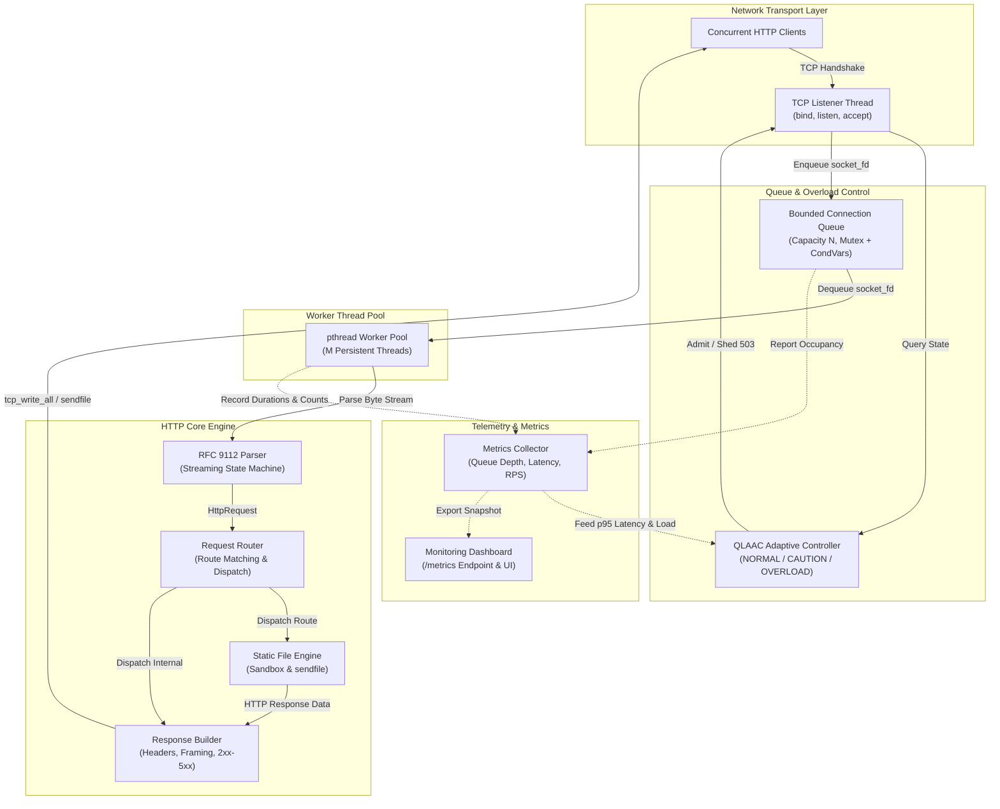
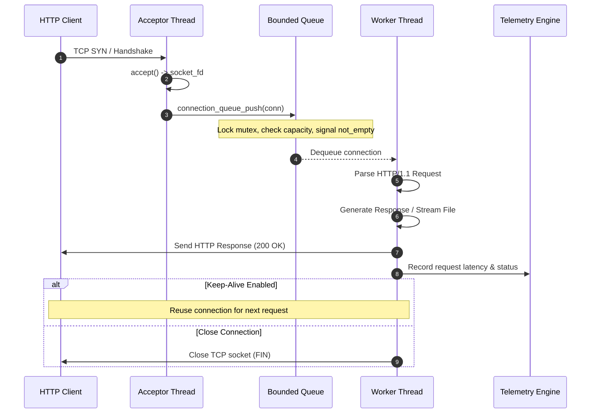

# System Architecture & Design Specification

## 1. Overview & Architectural Philosophy

The objective of this project is to implement a high-performance, resilient, and academically rigorous HTTP/1.1 web server in **C17** directly on top of **raw POSIX TCP sockets** and **pthreads**. The architecture is designed from first principles without relying on third-party frameworks, embedded HTTP engines, or external parsing libraries.

The server architecture adheres to four core engineering principles:
1. **Explicit Resource Boundaries**: Memory allocations, thread counts, and queue depths are bounded at compile-time or startup to eliminate unbounded resource exhaustion.
2. **Deterministic Concurrency**: A pre-allocated worker thread pool handles client requests, eliminating the prohibitive latency and operating-system thread creation overhead of per-connection threading models.
3. **Defensive Protocol Adherence**: Input parsing complies strictly with RFC 9112, treating all socket streams as untrusted byte sequences that may be fragmented, malformed, or hostile.
4. **Active Runtime Observability**: Core runtime telemetry is collected in real time to feed both a local web dashboard and an experimental adaptive admission-control engine.

---

## 2. Architectural Block Diagram

---

## 3. Subsystem Breakdown & Component Responsibilities

### 3.1 Network Transport Layer (`tcp_socket.c`, `include/tcp_socket.h`)
- **Initialization**: Creates a master stream socket with `socket(AF_INET, SOCK_STREAM, 0)`.
- **Socket Options**: Applies `SO_REUSEADDR` to allow rapid server restart, `TCP_NODELAY` where low-latency header flushing is desired, and `SO_RCVTIMEO` / `SO_SNDTIMEO` to prevent slow-client thread starvation.
- **Connection Handshake**: Binds to designated address/port and invokes `listen()` with configured backlog. Accepts incoming connections via `accept()` and records remote IP/port metadata.
- **Stream I/O**: Encapsulates robust loops for `recv()` and `send()` to account for TCP byte-stream fragmentation, `EAGAIN`/`EWOULDBLOCK`, and partial socket writes.

### 3.2 Bounded Connection Queue (`connection_queue.c`, `include/connection_queue.h`)
- **Data Structure**: A thread-safe circular FIFO buffer storing accepted `ClientConnection` structures.
- **Synchronization**: Protected by a single `pthread_mutex_t` and two condition variables:
  - `not_empty`: Worker threads wait on this variable when no client connections are pending.
  - `not_full`: The listener thread waits on this variable if the queue reaches its maximum capacity.
- **Resource Protection**: Prevents memory bloat during sudden traffic spikes by establishing a hard upper limit on queued connections.

### 3.3 Worker Thread Pool (`thread_pool.c`, `include/thread_pool.h`)
- **Worker Allocation**: Spawns a fixed pool of $M$ threads at startup (configured in `server.conf`).
- **Worker Loop**: Workers run an infinite loop waiting on the connection queue. Upon acquiring a socket descriptor, the worker takes exclusive ownership of the socket.
- **Connection Processing**: The worker performs the entire HTTP request-response cycle, including keep-alive loop handling, and closes the descriptor upon termination.
- **Graceful Teardown**: Upon receiving a shutdown signal, threads finish active requests, drain the queue, and terminate cleanly via `pthread_join()`.

### 3.4 RFC 9112 HTTP Parser (`http_parser.c`, `include/http_parser.h`)
- **Streaming Parser**: A zero-copy / bounded-copy streaming state machine that ingests bytes chunk-by-chunk without expecting complete requests in a single read.
- **Request-Line Grammar**: Strictly parses and validates `Method SP Request-URI SP HTTP-Version CRLF`.
- **Header Parsing**: Extracts headers, enforces size limits (8 KB maximum cumulative headers), normalizes keys, and provides case-insensitive header lookup.
- **Framing Evaluation**: Extracts and verifies `Content-Length`. Accurately identifies `Connection: keep-alive` vs `Connection: close`.

### 3.5 Routing & Static File Engine (`router.c`, `static_files.c`)
- **Route Matching**: Directs incoming requests based on HTTP method and normalized URI.
- **Virtual Endpoints**: Handles dynamic endpoints such as `/metrics` directly in memory.
- **Static File Handling**: Resolves static assets against `./public`. Enforces path canonicalization (`realpath`) to block directory traversal attacks.
- **Zero-Copy Optimization**: Utilizes Linux `sendfile(2)` for high-throughput static file delivery directly from kernel cache.

### 3.6 Observability Engine (`metrics.c`, `include/metrics.h`)
- **Thread-Safe Telemetry**: Aggregates throughput, active workers, queue occupancy, status code counts, and latency percentiles ($p50$, $p95$, $p99$).
- **Exporting**: Serializes real-time metrics snapshots into JSON for browser visualization and the QLAAC controller.

---

## 4. Concurrency & Synchronization Model

---

## 5. Architectural Invariants

1. **Descriptor Exclusivity**: A socket file descriptor is owned by at most one thread at any point in time. Once popped from the queue, only the designated worker thread may read, write, or close that socket.
2. **Deterministic Memory Footprint**: No memory allocations scale with the volume of concurrent requests beyond the configured queue capacity and worker pool size.
3. **Non-Blocking Observability**: Metric updates use minimal critical-section locks and never block on network or disk I/O.
